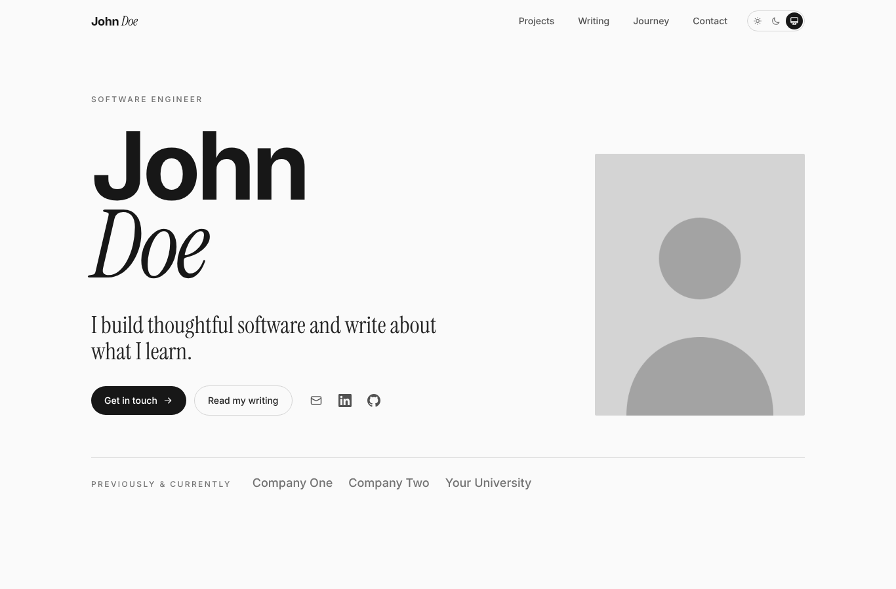

# Portfolio Template

A personal website with a home page, a blog, and an editor for writing posts in your browser. It's free to host, and once it's set up you never have to touch code to keep it running.



**What you get:**

- A home page with your name, a short intro, your projects, your timeline, and a way to contact you
- A blog with a clean reading layout, share buttons, an RSS feed, and light and dark mode
- A writing editor at `/keystatic` where you write posts like you would in a doc, then click save to publish

This started as my own site. I turned it into a template because setting up a personal site used to take me weeks, and it shouldn't have to. I hope it saves you some time.

---

## Before you start

**Time:** about an hour, spread across the steps below. You can stop after any step and come back later.

**You'll need two free accounts:**

1. **GitHub** ([github.com](https://github.com)): where your site's files live. Think of it as a shared folder that remembers every change.
2. **Vercel** ([vercel.com](https://vercel.com)): what puts your site on the internet. Sign up with your GitHub account so the two can talk to each other.

**Optional:**

- **Your own domain** (like `johndoe.com`), about $10 to $15 a year. You can add it any time. Until then, Vercel gives you a free address.
- **Claude Code** or a similar AI coding tool, if you'd rather describe changes in plain English than edit files yourself. See [Using Claude Code](#using-claude-code-optional) below.

**No coding needed.** You'll edit one settings file, and the instructions show you exactly what to change.

**How this guide works:** each step says what to do and why you're doing it. Take them one at a time. If something doesn't look right, check [If something goes wrong](#if-something-goes-wrong) at the bottom.

---

## Step 1: Make your own copy

**Why:** this gives you your own copy of the site that you control. Changes you make won't affect anyone else's.

1. At the top of this page on GitHub, click the green **Use this template** button, then **Create a new repository**.
2. Under **Repository name**, type a name, like `portfolio` or `johndoe-site`.
3. Choose **Public** or **Private**. Either works. Private keeps your files hidden; your website itself is public either way.
4. Click **Create repository**.

You now have your own copy. Everything from here happens in your copy, not this one.

---

## Step 2: Put it online

**Why:** Vercel takes the files in your repository, builds them into a website, and hosts it for free. It also rebuilds your site automatically every time something changes, so you never have to "upload" anything again.

1. Go to [vercel.com/new](https://vercel.com/new) and sign in with GitHub.
2. Find your new repository in the list and click **Import**. If you don't see it, click **Adjust GitHub App Permissions** and give Vercel access to it.
3. Leave every setting as it is and click **Deploy**.
4. Wait a minute or two. When you see the confetti, click the preview to open your site.

You'll get an address like `your-repo-name.vercel.app`. Your site is live, but it still says "John Doe." That's next.

---

## Step 3: Make it yours

**Why:** all of your personal details (name, links, timeline, projects) live in one file, so you only have to change them in one place.

The file is **`src/lib/site-content.ts`**. Here's how to edit it without installing anything:

1. In your repository on GitHub, click into the `src` folder, then `lib`, then `site-content.ts`.
2. Click the **pencil icon** (top right of the file) to edit.
3. Change the values inside the quotes. Each one has a short note above it explaining what it's for. The ones to change first:

   | Setting | What to put |
   |---|---|
   | `firstName`, `lastName` | Your name |
   | `role` | What you do, like "Software Engineer" or "Designer" |
   | `tagline` | One sentence about you |
   | `url` | Your site's address from Step 2, like `https://johndoe.vercel.app` |
   | `email` | Where people can reach you |
   | `githubRepo` | Your GitHub username and repository name, like `johndoe/portfolio` |
   | `SOCIAL_LINKS` | Your LinkedIn and GitHub links |
   | `PLACES`, `STATIC_PROJECTS`, `JOURNEY` | Your work, projects, and timeline |

4. Scroll down and click **Commit changes**, then **Commit changes** again.

Vercel will notice the change and rebuild your site. Refresh it in a minute or two and you'll see your name.

**A note on the quotes:** keep the `"quotation marks"` and the commas at the ends of lines. If the site stops updating after an edit, a missing quote or comma is the usual reason. Vercel will show the build as failed, and you can fix the line and commit again.

### Add your photo

1. In your repository, open the `public` folder.
2. Click **Add file**, then **Upload files**, and drag in your photo. A JPG or PNG works best; a portrait (taller than it is wide) looks best on the home page.
3. Commit the upload.
4. Back in `site-content.ts`, change `photo` to match your file's name, like `"/my-photo.jpg"`. Keep the slash at the start.

### Change the site icon (optional)

The little icon in the browser tab is in `public/favicon`. It says "JD" for now. To replace it, make a square image and upload it at each of the sizes in that folder, using the same file names. Sites like [realfavicongenerator.net](https://realfavicongenerator.net) will make every size for you from one image.

---

## Step 4: Turn on the writing editor

**Why:** the editor at `/keystatic` saves your posts directly into your GitHub repository. To do that, GitHub needs to know the editor is allowed to save there for you. You set that up once by creating a small "GitHub App" (a permission slip, essentially), then giving Vercel its keys.

This is the longest step. Take it slowly; every value you need is listed.

### 4a. Create the GitHub App

1. Go to [github.com/settings/apps/new](https://github.com/settings/apps/new).
2. Fill in:
   - **GitHub App name:** anything unique, like `johndoe-site-editor`.
   - **Homepage URL:** your site's address, like `https://johndoe.vercel.app`.
   - **Callback URL:** your site's address followed by `/api/keystatic/github/oauth/callback`. For example: `https://johndoe.vercel.app/api/keystatic/github/oauth/callback`
   - Tick **Request user authorization (OAuth) during installation**.
   - Under **Webhook**, untick **Active**. (The editor doesn't need it.)
3. Under **Permissions**, open **Repository permissions** and set:
   - **Contents:** Read and write (so it can save posts)
   - **Pull requests:** Read-only
   - **Metadata** is set to Read-only automatically. Leave it.
4. Under **Where can this GitHub App be installed?**, choose **Only on this account**.
5. Click **Create GitHub App**.

### 4b. Copy its keys

You're now on the app's settings page. Keep it open. You need three things from it, plus one you make up:

| Name | Where to find it |
|---|---|
| `KEYSTATIC_GITHUB_CLIENT_ID` | Shown near the top as **Client ID** |
| `KEYSTATIC_GITHUB_CLIENT_SECRET` | Click **Generate a new client secret** and copy it right away. GitHub only shows it once |
| `NEXT_PUBLIC_KEYSTATIC_GITHUB_APP_SLUG` | The last part of this page's address. If the address is `github.com/settings/apps/johndoe-site-editor`, the slug is `johndoe-site-editor` |
| `KEYSTATIC_SECRET` | Make this up: any random string of 40 or more letters and numbers. A password generator works well |

Treat the client secret and `KEYSTATIC_SECRET` like passwords. Don't post them anywhere or put them in your repository.

### 4c. Install the app on your repository

1. On the app's settings page, click **Install App** in the left sidebar, then **Install** next to your account.
2. Choose **Only select repositories**, pick your site's repository, and click **Install**.
3. If GitHub asks you to authorize the app, click **Authorize**.

### 4d. Give the keys to Vercel

1. In Vercel, open your project, then **Settings**, then **Environment Variables**.
2. Add each of the four names from 4b with its value, one at a time. Leave all environments ticked, and click **Save** after each.
3. Go to the **Deployments** tab, click the **⋯** menu on the top deployment, and choose **Redeploy**. (Vercel only picks up new keys when it rebuilds.)

### 4e. Try it

Open your site's address with `/keystatic` on the end, like `https://johndoe.vercel.app/keystatic`, and click **Log in with GitHub**. You should see a **Posts** list with the sample "Hello, world" post in it.

If it says "Keystatic is not set up yet," Vercel doesn't have all four keys yet, or it hasn't redeployed since you added them.

---

## Step 5: Write your first post

**Why:** this is the whole point. After this step, writing a post never involves code.

1. Go to `/keystatic` and click **Posts**, then the **+** button.
2. Add a **title**, a one or two sentence **excerpt** (it shows on your blog page and in link previews), and write your post.
3. Click **Create**.

About a minute later, your post is live at `/blog`, and the newest three show up on your home page.

**Good to know:**

- **Drafts:** tick **Draft** to save a post without publishing it.
- **The sample post:** open "Hello, world" and click the trash icon to delete it whenever you're ready.
- **Why the minute's wait:** each save is saved to GitHub as a change, and Vercel rebuilds the site to include it.

---

## Step 6: Use your own domain (optional)

**Why:** `johndoe.com` is easier to share and remember than `johndoe-site.vercel.app`.

1. Buy a domain from any registrar (Cloudflare, Namecheap, Porkbun, and Squarespace all work), or buy one directly in Vercel under **Domains**.
2. In your Vercel project, go to **Settings**, then **Domains**, type your domain, and click **Add**.
3. Vercel shows one or two records to add at your registrar. Copy them exactly. This can take anywhere from a few minutes to a few hours to start working.
4. Once it works, update two things to use the new address:
   - `url` in `src/lib/site-content.ts`
   - Your GitHub App's **Callback URL** (from Step 4a). Click **Add Callback URL** and add the new one; you can keep the old one too.

---

## Step 7: Let people subscribe (optional)

**Why:** people who like your writing can get new posts by email instead of having to remember to check.

Your blog already has an RSS feed at `/rss.xml`, which feed readers use. For email:

1. Make a free account at [buttondown.com](https://buttondown.com).
2. In `src/lib/site-content.ts`, set `NEWSLETTER_FORM_ACTION` to `"https://buttondown.com/api/emails/embed-subscribe/YOUR-BUTTONDOWN-USERNAME"`.
3. Commit. An email signup box will appear on your blog.

Buttondown stores your subscribers, so you don't need a database.

---

## Using Claude Code (optional)

You don't need an AI tool for anything above. But if you'd rather describe a change than edit a file, Claude Code works from the browser:

1. Go to [claude.ai/code](https://claude.ai/code) and connect your GitHub account.
2. Start a session on your site's repository.
3. Ask for what you want in plain English. Some examples:
   - "Update site-content.ts with my details: my name is …, my role is …"
   - "Add a project called … with this description: …"
   - "Change the accent color of the buttons to dark green."
   - "Walk me through Step 4 of the README."

Claude makes the change on a separate branch and can open a pull request for you. Vercel builds a preview of every pull request, so you can look at the change before it goes live, then merge it when you're happy.

One honest suggestion: ask it to explain what it changed and why. When something breaks, it's much easier to fix if you understand how it was built.

---

## If something goes wrong

**The site didn't update after I edited a file.**
Open your Vercel project and look at the newest deployment. If it says **Error**, click it to see why. Most often it's a missing quote or comma in `site-content.ts`. Fix the line and commit again.

**`/keystatic` says "Keystatic is not set up yet."**
Vercel is missing one of the four keys from Step 4b, or hasn't rebuilt since you added them. Check the names are spelled exactly right, then redeploy.

**GitHub says "redirect_uri is not associated with this application."**
The Callback URL in your GitHub App doesn't match your site's address exactly. Check for `https://`, typos, or a missing `/api/keystatic/github/oauth/callback` at the end.

**I can log in to the editor, but saving fails.**
The GitHub App probably isn't installed on your repository (Step 4c), or `githubRepo` in `site-content.ts` doesn't match your repository's name.

**Something broke and I want to go back.**
In Vercel, open **Deployments**, find the last version that worked, click **⋯**, and choose **Promote to Production** (or **Instant Rollback**). Your site goes back to that version immediately while you figure out what happened.

---

## Keeping it running

Once it's set up, the site mostly takes care of itself. There's a short checklist of occasional upkeep (a few minutes a month) in **[docs/UPKEEP.md](docs/UPKEEP.md)**.

## How it works

If you're curious what's under the hood, or want to explain it in an interview, **[docs/HOW-IT-WORKS.md](docs/HOW-IT-WORKS.md)** walks through how the pieces fit together and the tradeoffs behind them.

## For developers

```bash
npm install
npm run dev      # http://localhost:3000, editor at /keystatic (saves to _posts/ on your computer)
npm run build
```

Built with Next.js, React, TypeScript, Tailwind CSS, and Keystatic.

## License

MIT. Use it, change it, make it yours. A link back is appreciated, but never required.
